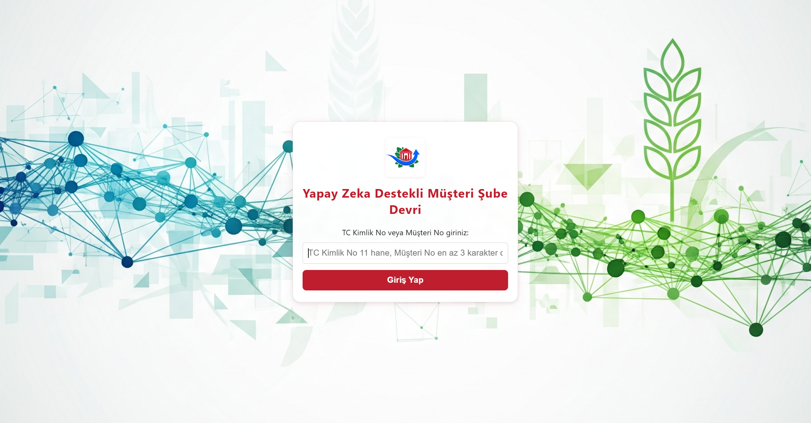
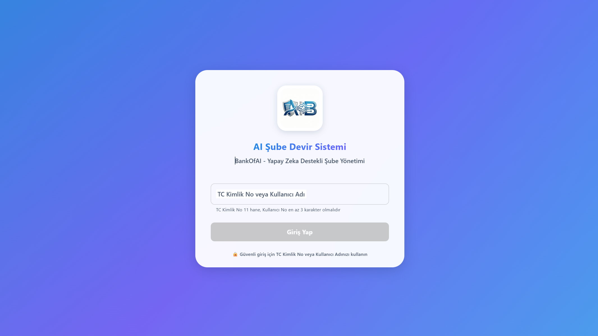
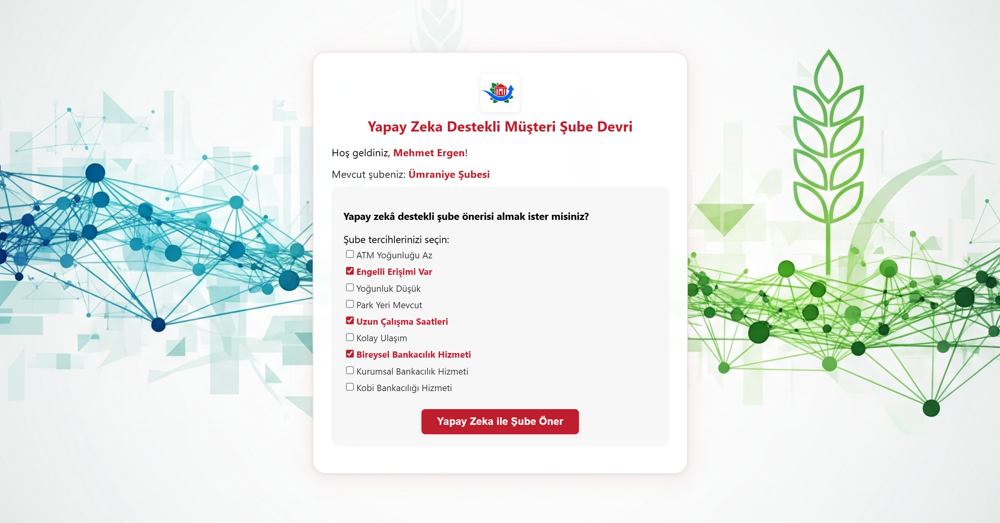
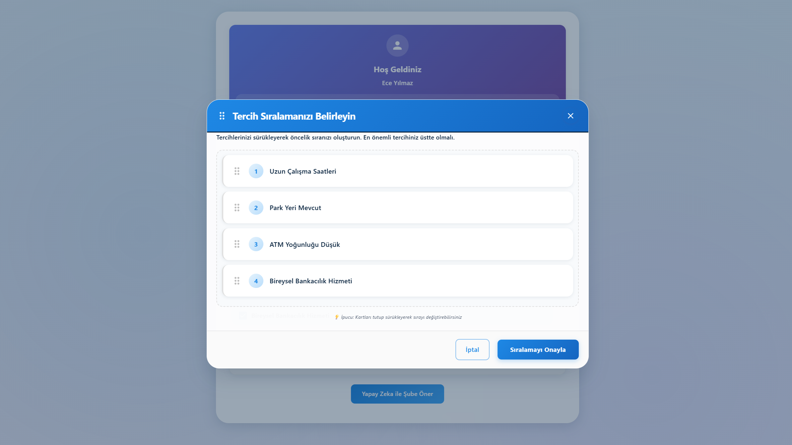
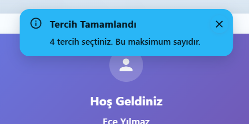

<div align="center">

# 🏦 AI-Powered Customer Branch Transfer

[](CHANGELOG.md)
[](https://reactjs.org/)
[](https://mui.com/)
[](LICENSE)
[](CONTRIBUTING.md)

**Next-Generation Banking Interface** | AI-Driven Branch Recommendations with Premium Drag-and-Drop Experience

[🇹🇷 Türkçe](README.tr.md) | [📖 Changelog](CHANGELOG.md) | [🐛 Report Bug](../../issues) | [✨ Request Feature](../../issues)

**Developed by Yunus Emre Gümüş**

</div>

---

## 🌟 Highlights

- **Intelligent AI** - Powered by Mistral AI & Gemini for personalized branch matching
- **Premium UX** - Glassmorphism design with Material-UI components
- **React 18 Ready** - Bug-free drag-and-drop with custom Strict Mode wrapper
- **Smart Feedback** - Context-based Toast notification system
- **Banking Theme** - Professional blue color palette (#1E88E5)
- **Fully Responsive** - Optimized for all screen sizes
- **Clean Architecture** - Scalable backend with layered design

---

## 📸 Design Evolution

### Version 2.0 vs 1.0 Comparison

<table>
<tr>
<th width="50%">Legacy v1.0</th>
<th width="50%">Premium v2.0</th>
</tr>
<tr>
<td>

#### Login Screen


**Issues:**
- ❌ Basic inline CSS
- ❌ Red color scheme
- ❌ No animations
- ❌ Limited responsiveness

</td>
<td>

#### Login Screen


**Improvements:**
- ✅ Material-UI components
- ✅ Banking blue theme
- ✅ Smooth animations
- ✅ Fully responsive

</td>
</tr>
<tr>
<td>

#### Preference Sorting


**Issues:**
- ❌ Drag offset bugs (React 18)
- ❌ Jumpy animations
- ❌ Plain design

</td>
<td>

#### Preference Sorting


**Improvements:**
- ✅ Pixel-perfect drag-drop
- ✅ Glassmorphism effects
- ✅ Professional polish

</td>
</tr>
<tr>
<td colspan="2" align="center">

#### Toast Notifications (NEW in v2.0)


</td>
</tr>
</table>

---

## 🚀 Quick Start

### Prerequisites

- **Node.js** 18+ and npm
- **Git**
- **Mistral AI API Key** (get it from [console.mistral.ai](https://console.mistral.ai))

### Installation

```bash
# Clone repository
git clone https://github.com/emregumusai/ai-branch-transfer-system.git
cd ai-branch-transfer-system

# Install backend dependencies
cd AIMusteriSubeDevir/backend
npm install

# Create .env file with API key
echo "MISTRAL_API_KEY=your_api_key_here" > .env

# Install frontend dependencies
cd ../frontend
npm install
```

### Running the Application

```bash
# Terminal 1: Start backend (port 5000)
cd AIMusteriSubeDevir/backend
node app.js

# Terminal 2: Start frontend (port 3001)
cd AIMusteriSubeDevir/frontend
$env:PORT=3001  # Windows PowerShell
# or export PORT=3001  # Linux/Mac
npm start
```

Open [http://localhost:3001](http://localhost:3001) in your browser.

---

## 🛠️ Tech Stack

### Frontend
- **React** 19.1.0 - UI library with Strict Mode
- **Material-UI** 7.3.8 - Component library & design system
- **Redux Toolkit** - State management
- **@hello-pangea/dnd** 18.0.1 - Drag-and-drop functionality
- **Emotion** - CSS-in-JS styling
- **Axios** - HTTP client

### Backend
- **Node.js** + Express 5.1.0
- **Mistral AI** - Primary AI provider (with Gemini fallback)
- **Clean Architecture** - Layered design pattern (controllers, services, repositories)
- **JSON Storage** - File-based data persistence

### DevOps
- Git version control
- Semantic versioning (SemVer)
- Conventional commits
- GitHub Issues & Projects
- Automated workflows

---

## 🎨 Architecture

### Component Structure
```
src/
├── components/
│   ├── common/              # Reusable components
│   │   ├── Toast.js         # Notification system
│   │   ├── Button.js
│   │   ├── Loading.js
│   │   └── ErrorAlert.js
│   ├── features/            # Feature-specific components
│   │   ├── LoginForm.js
│   │   ├── WelcomeScreen.js
│   │   ├── PreferenceSelector.js
│   │   ├── BranchSelectionOptions.js
│   │   ├── TercihSiralama.js
│   │   ├── AIRecommendationCard.js
│   │   ├── SuccessMessage.js
│   │   └── UserGreeting.js
│   └── ...
├── store/
│   └── slices/
│       ├── authSlice.js     # Redux auth state
│       ├── branchSlice.js
│       └── recommendationSlice.js
├── theme/
│   └── theme.js             # MUI theme configuration
└── App.js                   # Root component
```

### Backend Architecture
```
backend/
├── src/
│   ├── config/              # Configuration files
│   ├── constants/           # Application constants
│   ├── controllers/         # Request handlers
│   ├── middlewares/         # Express middlewares
│   ├── repositories/        # Data access layer
│   ├── routes/              # API routes
│   ├── services/
│   │   ├── ai/              # AI provider services
│   │   ├── branch/          # Branch logic
│   │   └── scoring/         # Scoring algorithms
│   ├── utils/               # Utility functions
│   └── validators/          # Input validation
├── app.js                   # Main server file
└── package.json
```

---

## 🔑 Key Technical Decisions

### React 18 Strict Mode Compatibility
**Problem:** @hello-pangea/dnd had coordinate calculation issues due to double-rendering.

**Solution:**
```javascript
// Custom wrapper with requestAnimationFrame
const StrictModeDroppable = ({ children, ...props }) => {
    const [enabled, setEnabled] = useState(false);
    
    useEffect(() => {
        const frame = requestAnimationFrame(() => setEnabled(true));
        return () => cancelAnimationFrame(frame);
    }, []);
    
    if (!enabled) return null;
    return <Droppable {...props}>{children}</Droppable>;
};
```

### Toast Notification System
**Replaced:** Static Alert components  
**With:** Context-based provider pattern

```javascript
// Usage anywhere in the app
const { showToast } = useToast();
showToast('Transfer successful!', 'success');
```

### Material-UI Theming
**Centralized** color palette and component overrides:
```javascript
// theme.js
export const theme = createTheme({
  palette: {
    primary: { main: '#1E88E5' },      // Banking blue
    secondary: { main: '#6C63FF' },    // Purple accent
    success: { main: '#00D395' },      // Success green
  },
  // ... component overrides
});
```

---

## 📚 Documentation

- [**Changelog**](CHANGELOG.md) - Version history and release notes
- [**Contributing**](CONTRIBUTING.md) - How to contribute to the project
- [**Turkish README**](README.tr.md) - Türkçe dokümantasyon
- [**Known Issues**](../../issues?q=is%3Aissue+is%3Aopen+label%3Abug) - Current bugs and limitations
- [**Feature Requests**](../../issues?q=is%3Aissue+is%3Aopen+label%3Aenhancement) - Planned features

---

## 🗺️ Roadmap

### ✅ Completed (v2.0)
- [x] Material-UI migration
- [x] Banking professional theme
- [x] Toast notification system
- [x] React 18 drag-drop fix (StrictModeDroppable)
- [x] Glassmorphism UI effects
- [x] Clean Architecture in backend
- [x] Redux Toolkit state management

### 🚧 In Progress (v2.1)
- [ ] Dark mode support
- [ ] Accessibility audit (WCAG AAA)
- [ ] Performance optimizations (code splitting, lazy loading)
- [ ] Unit test coverage

### 📋 Planned (v3.0)
- [ ] Multi-language support (i18n)
- [ ] Advanced AI model selection (GPT-4, Claude)
- [ ] Branch location map integration (Google Maps API)
- [ ] Real-time analytics dashboard
- [ ] Mobile app (React Native)
- [ ] Docker containerization
- [ ] CI/CD pipeline

---

## 🤝 Contributing

We welcome contributions! Please see [CONTRIBUTING.md](CONTRIBUTING.md) for guidelines.

### Quick Contribution Guide

1. Fork the repository
2. Create a feature branch (`git checkout -b feature/amazing-feature`)
3. Commit changes (`git commit -m 'feat: add amazing feature'`)
4. Push to branch (`git push origin feature/amazing-feature`)
5. Open a Pull Request

### Commit Convention

We follow [Conventional Commits](https://www.conventionalcommits.org/):

```
feat: New feature
fix: Bug fix
docs: Documentation
style: Formatting
refactor: Code restructuring
test: Tests
chore: Maintenance
```

---

## 📄 License

MIT License - see [LICENSE](LICENSE) file for details.

### Free Usage
- Personal projects
- Educational purposes
- Academic research
- Non-commercial applications

### Commercial Usage
- Contact for licensing options
- Enterprise support available

---

## 👤 Author

**Yunus Emre Gümüş**
- GitHub: [@emregumusai](https://github.com/emregumusai)
- LinkedIn: [emregumusai](https://www.linkedin.com/in/emregumusai/)
- Email: yunusemregumusofc@gmail.com
- Repository: [ai-branch-transfer-system](https://github.com/emregumusai/ai-branch-transfer-system)

---

## 🙏 Acknowledgments

- Material-UI team for excellent component library
- @hello-pangea/dnd maintainers for React 18 compatible drag-drop
- Mistral AI for powerful language models
- Open-source community

---

## 💼 Commercial Usage

**This software requires explicit permission for commercial use in banks, corporations, or enterprise applications.**

**Contact for Commercial Licensing:**
- GitHub: [@emregumusai](https://github.com/emregumusai)
- LinkedIn: [emregumusai](https://www.linkedin.com/in/emregumusai/)
- Email: yunusemregumusofc@gmail.com
- **Please contact before implementing in production environments**

See [LICENSE](LICENSE) for complete terms and conditions.

## 🔒 Security Note

This is a demonstration project. For production use:
- Implement proper authentication and authorization
- Use secure database solutions
- Add encryption for sensitive data
- Follow banking security standards and regulations

## 📞 Support

For questions, issues, or commercial licensing inquiries:
- GitHub: [@emregumusai](https://github.com/emregumusai)
- LinkedIn: [emregumusai](https://www.linkedin.com/in/emregumusai/)
- Email: yunusemregumusofc@gmail.com
- Open an issue on [GitHub Issues](../../issues)

---

<div align="center">

**⭐ Star this repository if you find it helpful!**

[Report Bug](../../issues/new?template=bug_report.yml) · [Request Feature](../../issues/new?template=feature_request.yml) · [View Changelog](CHANGELOG.md)

Made with ❤️ by **Yunus Emre Gümüş**

</div>
